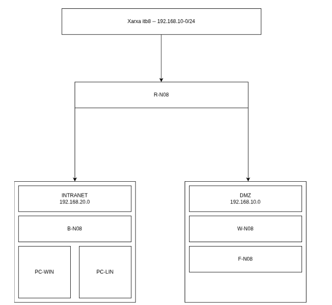

# Arquitectura

## Descripció

Infraestructura multicapa desplegada a Isard VDI amb un router (R-N08) que separa tres xarxes:

- **NAT/Internet (Default):** sortida a l'exterior del router.
- **DMZ (itb8):** serveis exposats, web (W-N08) i FTP (F-N08).
- **Intranet (itb18):** base de dades (B-N08) i clients.

El router fa NAT (masquerade), DHCP i DNS (dnsmasq) i filtra el trànsit amb nftables.

## Flux de l'aplicació

Client (Intranet) -> router -> W-N08 (Apache + PHP, DMZ) -> router (regla TCP 3306) -> B-N08 (MySQL, Intranet).

## Serveis

| Servei | Màquina | Programari |
|---|---|---|
| Router, NAT, tallafocs | R-N08 | Ubuntu, nftables |
| DHCP i DNS | R-N08 | dnsmasq |
| Web | W-N08 | Apache 2 + PHP 8.3 |
| Base de dades | B-N08 | MySQL 8.0 |
| FTP | F-N08 | vsftpd |
| SSH | Tots els servidors | OpenSSH |

Detall de cada màquina a [`servidors/`](servidors/).
