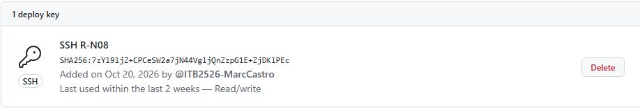
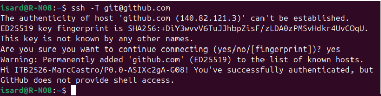
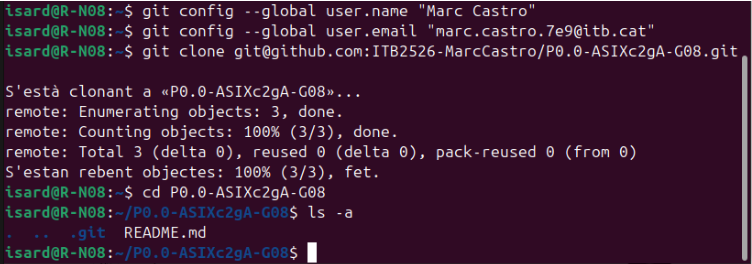
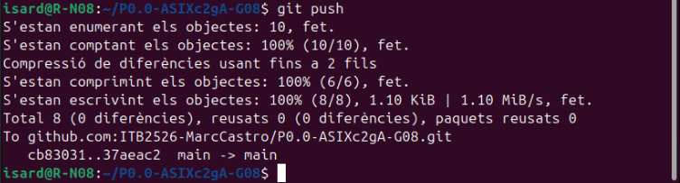
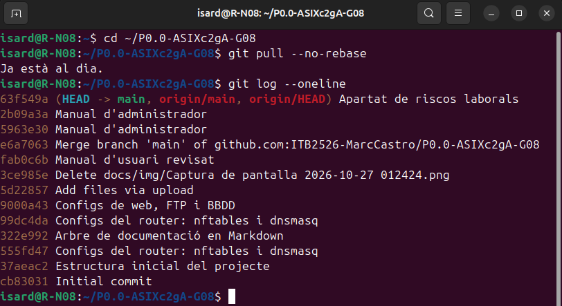

# Control de versions

## Validació per clau pública/privada

Al router R-N08 s'ha generat una clau ed25519 i la pública s'ha afegit al repositori com a *deploy key* amb permís d'escriptura.

```bash
ssh-keygen -t ed25519 -C "G08-projecte"
cat ~/.ssh/id_ed25519.pub
ssh -T git@github.com
```





> Incidència: la primera vegada la clau es va afegir en mode només lectura i el `push` fallava amb «The key you are authenticating with has been marked as read only». Es va solucionar esborrant-la i tornant-la a afegir amb *Allow write access*.

## Flux de treball

| Acció | Ordre |
|---|---|
| Clonar | `git clone git@github.com:ITB2526-MarcCastro/P0.0-ASIXc2gA-G08.git` |
| Afegir canvis | `git add .` |
| Registrar | `git commit -m "missatge"` |
| Pujar a producció | `git push` |
| Baixar canvis | `git pull` |






