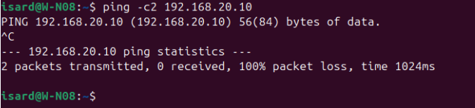
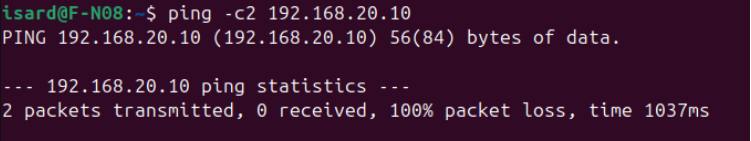
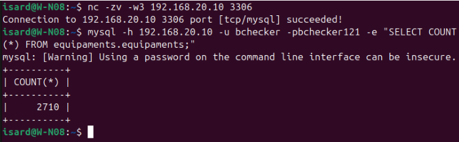
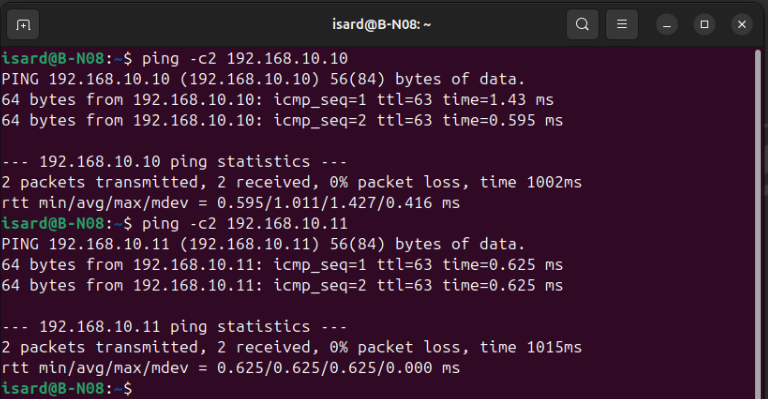

# Segmentació DMZ / Intranet

## Política del tallafocs (nftables al router)

| Origen | Destí | Resultat |
|---|---|---|
| Intranet | Tot (DMZ i Internet) | Permès |
| DMZ | Internet | Permès |
| W-N08 (192.168.10.10) | B-N08 (192.168.20.10) només TCP 3306 | Permès (excepció) |
| DMZ | Intranet (qualsevol altre) | **Bloquejat** (`policy drop`) |

Regla d'excepció:

Fitxer complet: [`configs/router/nftables.conf`](../configs/router/nftables.conf)

## Proves

### DMZ -> Intranet bloquejat

W-N08:

F-N08:

### W-N08 -> B-N08 pel port 3306 permès

### Intranet -> DMZ permès

