# B-N08: base de dades (Intranet)

MySQL 8.0, IP fixa 192.168.20.10.

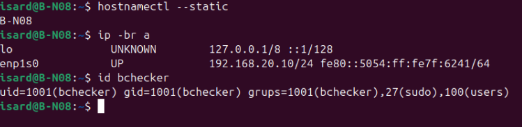

## Xarxa

Primer va rebre IP per DHCP del router (prova de DHCP, NAT i DNS) i després se li va fixar la IP.

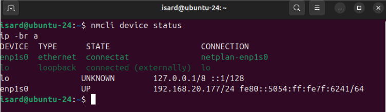

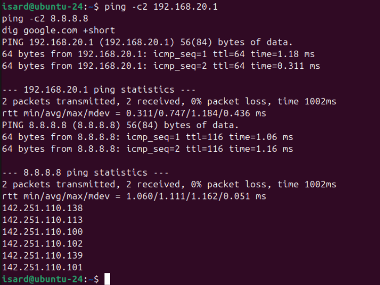

```bash
sudo nmcli connection modify netplan-enp1s0 ipv4.method manual ipv4.addresses 192.168.20.10/24 ipv4.gateway 192.168.20.1 ipv4.dns 192.168.20.1
sudo nmcli connection up netplan-enp1s0
```

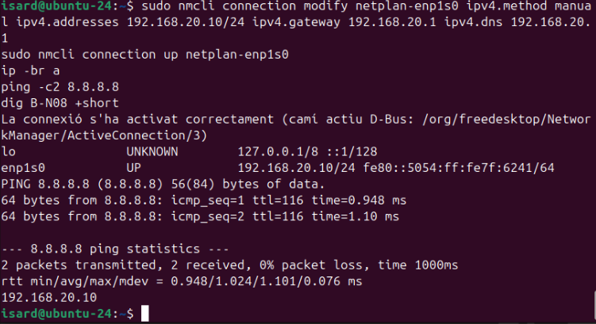

## Dades: equipaments d'educació de Barcelona

Origen: Open Data BCN (CSV).

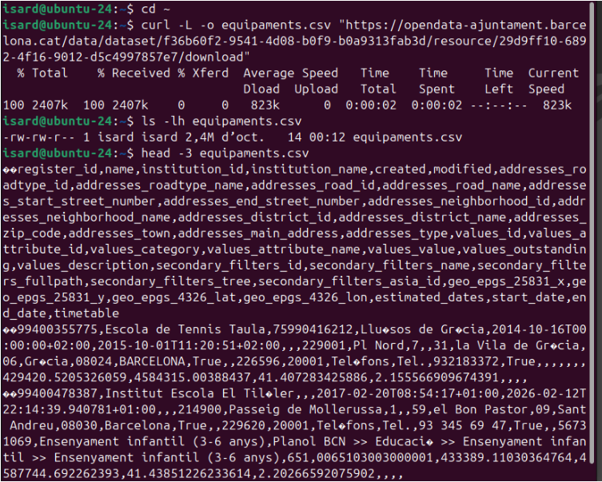

> Incidència: el CSV era UTF-16 little-endian (BOM `ff fe`), i els accents es veien trencats. Es va convertir a UTF-8 amb `iconv`.

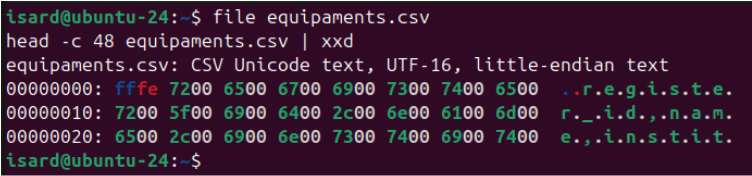

```bash
iconv -f UTF-16 -t UTF-8 equipaments.csv -o equipaments_utf8.csv
```

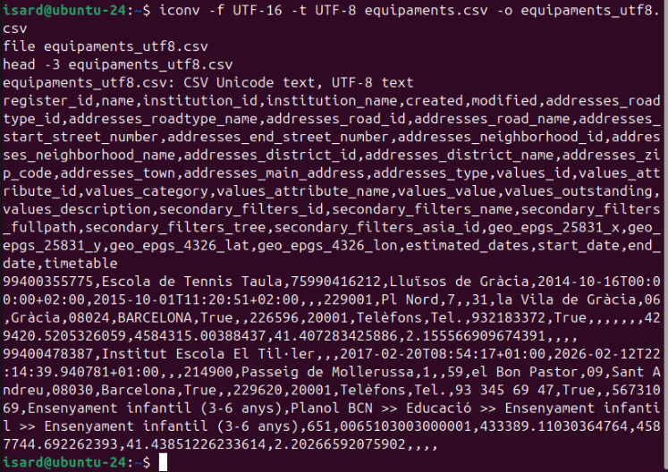

## Base de dades i usuari

```sql
CREATE DATABASE IF NOT EXISTS equipaments CHARACTER SET utf8mb4 COLLATE utf8mb4_unicode_ci;
CREATE USER IF NOT EXISTS 'bchecker'@'%' IDENTIFIED BY 'bchecker121';
GRANT ALL PRIVILEGES ON equipaments.* TO 'bchecker'@'%';
FLUSH PRIVILEGES;
```

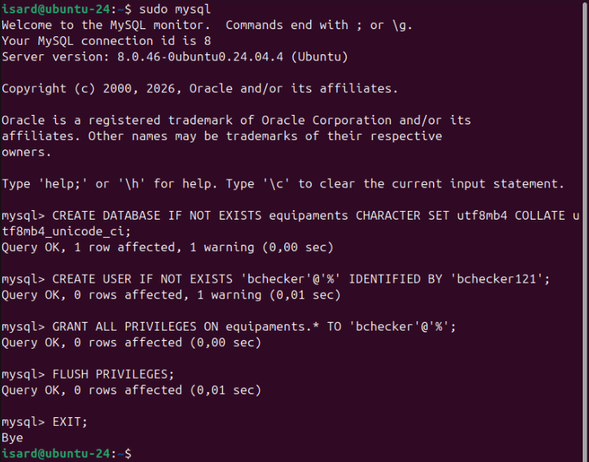

## Càrrega

Taula `equipaments` amb 40 columnes (tot text). Fitxer: [`configs/bbdd/equipaments.sql`](../../configs/bbdd/equipaments.sql)

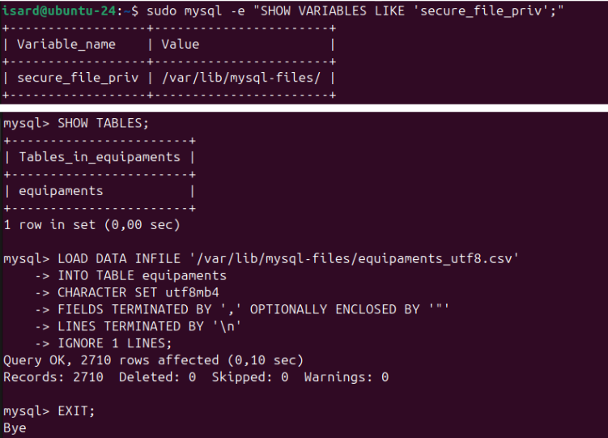

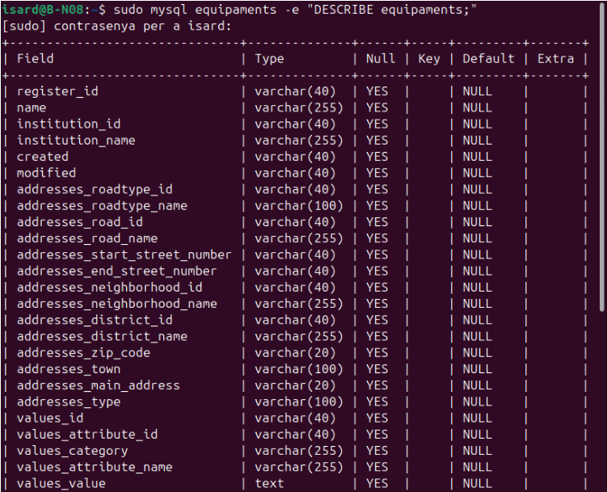

## Verificació

El CSV té una fila per atribut: 2710 files per 1982 equipaments únics.

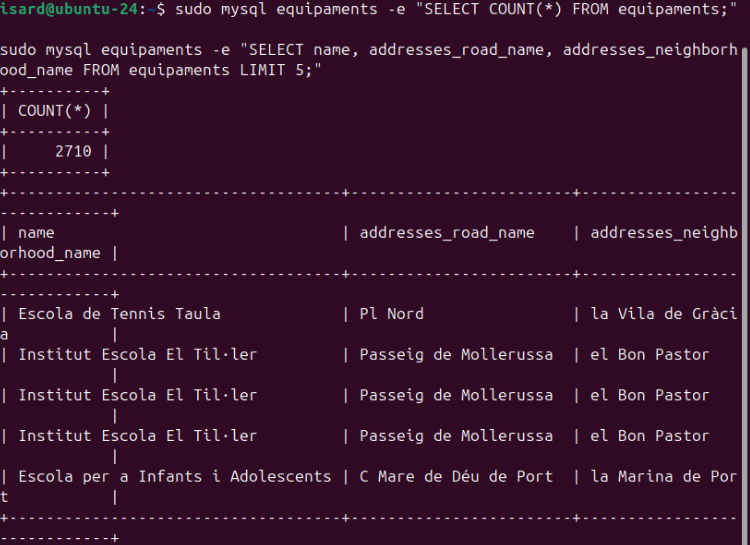

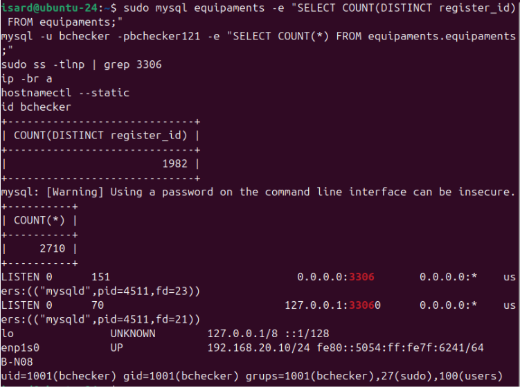

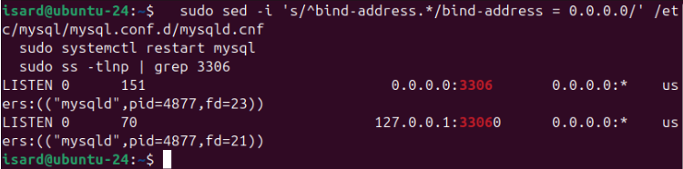
