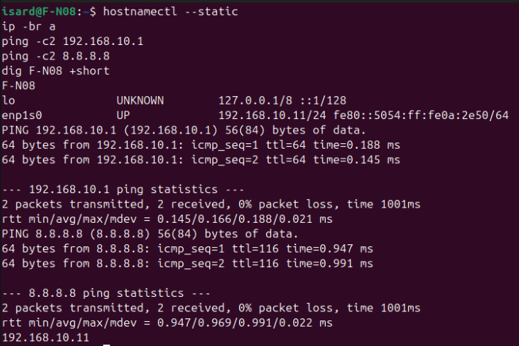
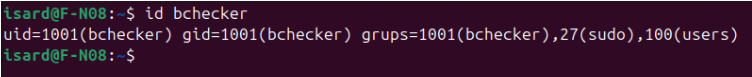
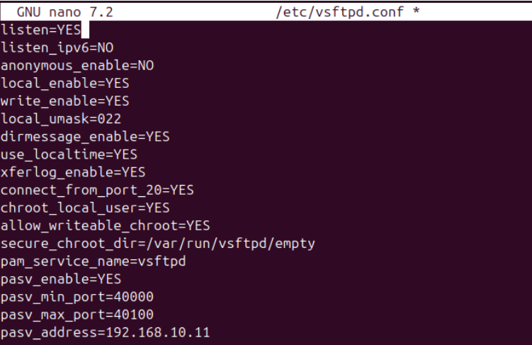
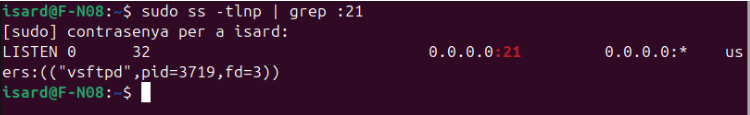
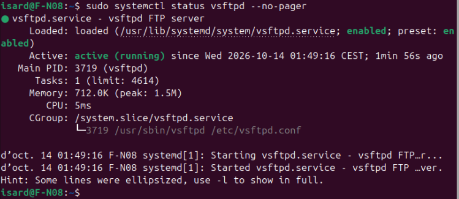
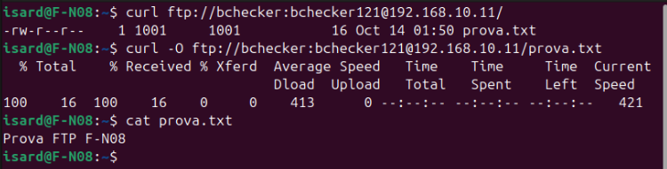
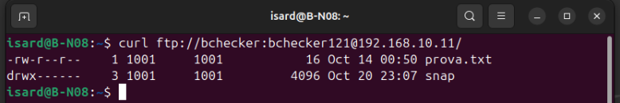

# F-N08: servidor FTP (DMZ)

vsftpd, IP fixa 192.168.10.11.

## Configuració

Sense accés anònim, usuaris locals amb chroot i mode passiu (ports 40000-40100). Fitxer: [`configs/ftp/vsftpd.conf`](../../configs/ftp/vsftpd.conf)

## Proves

Des del propi F-N08:

Des de la Intranet:

> Nota: FTP envia usuari i contrasenya en text pla. Millora possible: FTPS amb certificat.
