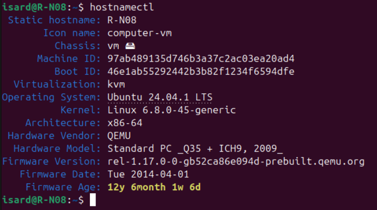
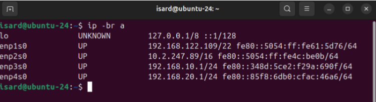
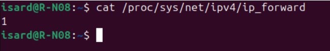
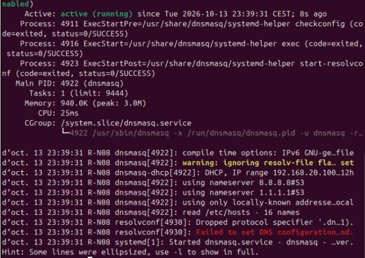
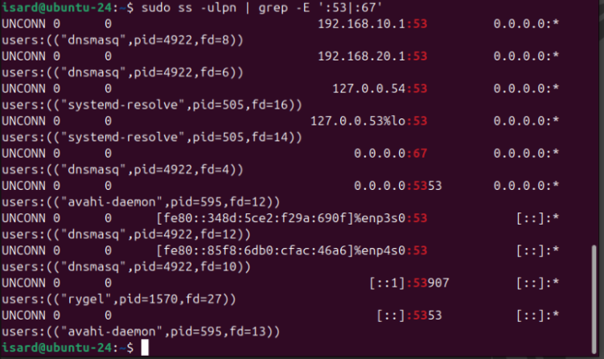
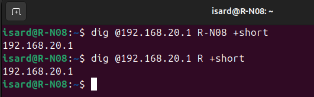
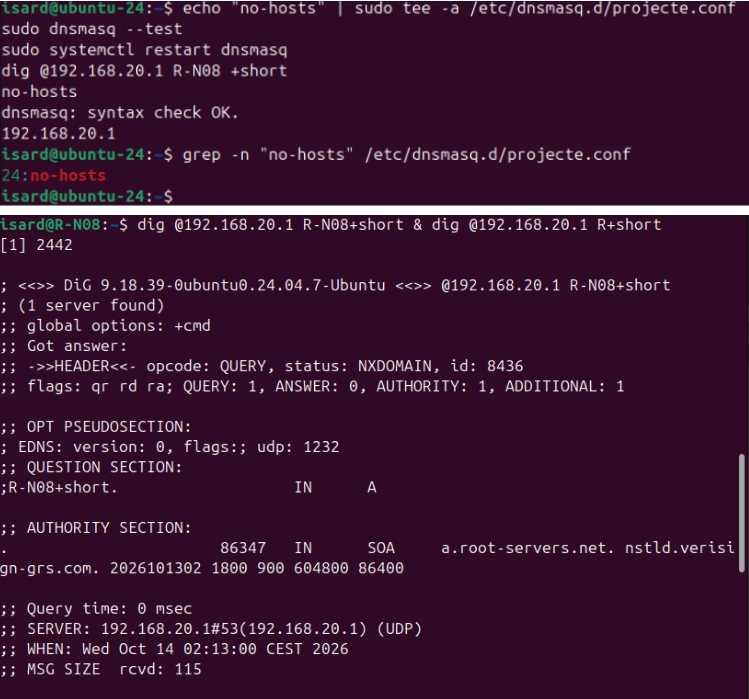
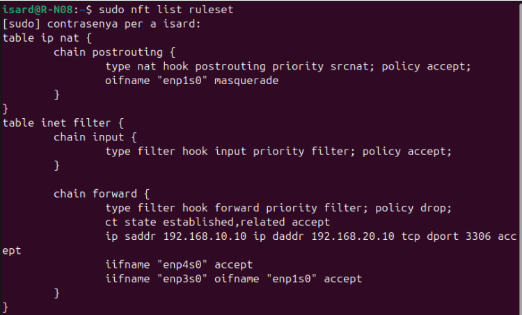
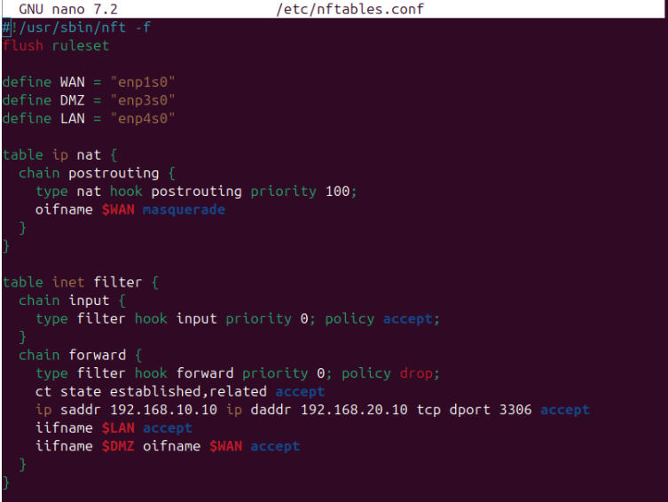
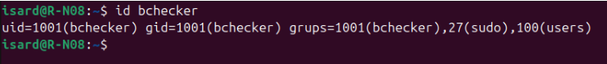

# Router R-N08

Funcions: gateway de DMZ i Intranet, NAT, tallafocs (nftables), DHCP i DNS (dnsmasq).



## Interfícies i IPs

Interfícies: enp1s0 Default (WAN), enp2s0 Wireguard (gestió), enp3s0 DMZ, enp4s0 Intranet.

```bash
sudo nmcli connection add type ethernet ifname enp3s0 con-name DMZ ipv4.method manual ipv4.addresses 192.168.10.1/24
sudo nmcli connection add type ethernet ifname enp4s0 con-name INTRANET ipv4.method manual ipv4.addresses 192.168.20.1/24
```



## Reenviament d'IP

```bash
echo "net.ipv4.ip_forward=1" | sudo tee /etc/sysctl.d/99-forward.conf
sudo sysctl --system
```



## DHCP i DNS (dnsmasq)

DHCP només a la Intranet (192.168.20.100-200). DNS resol `R-N08` i `R` cap al router, més els noms dels servidors. Fitxer: [`configs/router/projecte.conf`](../../configs/router/projecte.conf)





> Incidència: `dig R-N08` retornava també `127.0.1.1`, perquè dnsmasq llegia `/etc/hosts`. Es va solucionar afegint `no-hosts` a la configuració.





## Tallafocs i NAT (nftables)

Masquerade per la WAN i `policy drop` al forward, amb excepcions. Fitxer: [`configs/router/nftables.conf`](../../configs/router/nftables.conf). Detall a [segmentació](../segmentacio.md).





## Usuari


