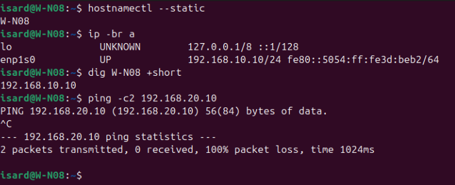
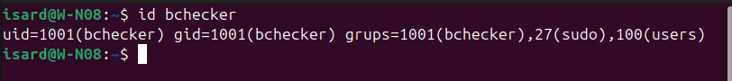
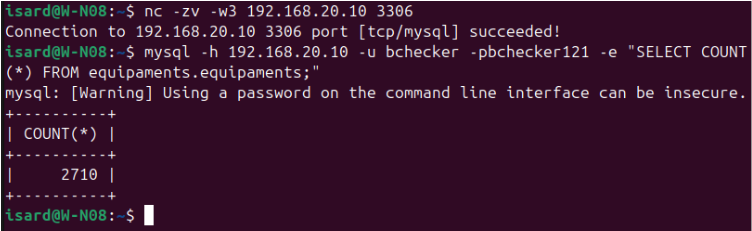
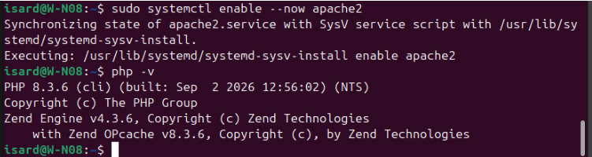
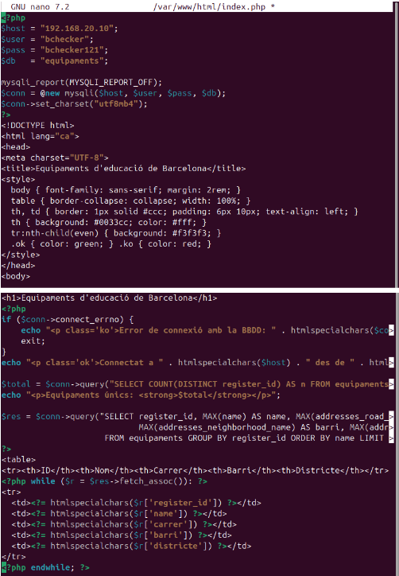
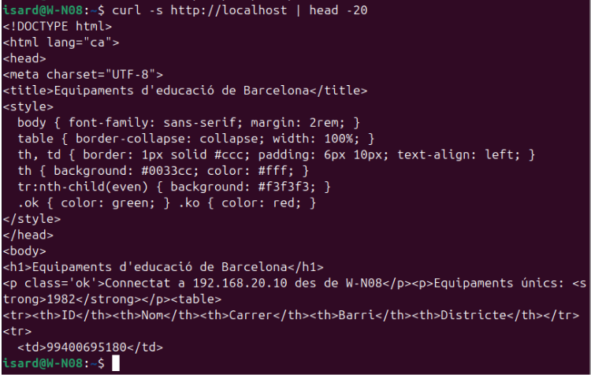
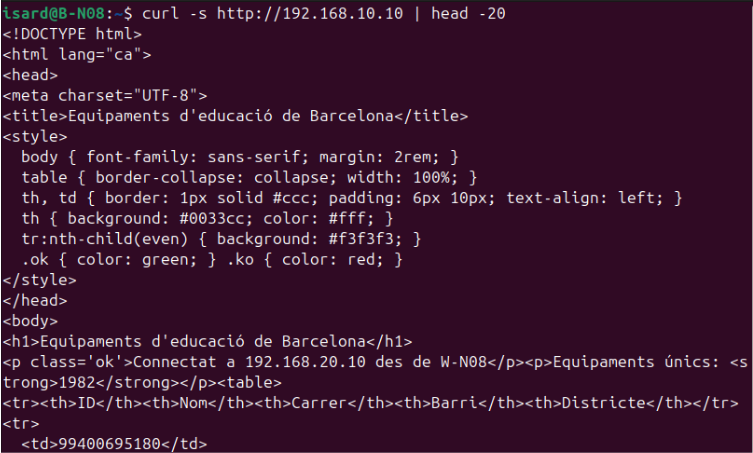

# W-N08: servidor web (DMZ)

Apache 2 + PHP 8.3, IP fixa 192.168.10.10.





## Accés a la BBDD

El router només deixa passar W-N08 -> B-N08 pel port 3306.



## Apache i PHP

```bash
sudo apt install -y apache2 php libapache2-mod-php php-mysql mysql-client
```



## Aplicació

`/var/www/html/index.php` mostra els equipaments únics (agrupats per `register_id`, primers 100). Fitxer: [`configs/web/index.php`](../../configs/web/index.php)







## Resultat al navegador


