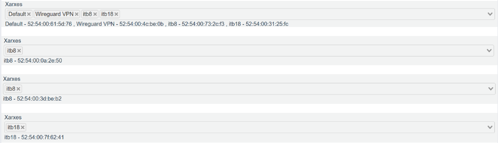

# Xarxa i pla d'adreçament

## Xarxes a Isard

| Xarxa Isard | Funció | Subxarxa | Ús |
|---|---|---|---|
| Default | Internet (NAT) | assignada per Isard | WAN del router (`enp1s0`) |
| Wireguard VPN | Gestió | assignada per Isard | Només accés d'administració (`enp2s0`) |
| itb8 | **DMZ** | 192.168.10.0/24 | W-N08, F-N08 (`enp3s0` del router) |
| itb18 | **Intranet** | 192.168.20.0/24 | B-N08 i clients (`enp4s0` del router) |

## Equips

| Equip | Rol | Xarxa | IP | Gateway / DNS |
|---|---|---|---|---|
| R-N08 | Router, DHCP, DNS | Default / DMZ / Intranet | DHCP / 192.168.10.1 / 192.168.20.1 | n/a |
| W-N08 | Servidor web | DMZ | 192.168.10.10 (fixa) | 192.168.10.1 |
| F-N08 | Servidor FTP | DMZ | 192.168.10.11 (fixa) | 192.168.10.1 |
| B-N08 | Base de dades | Intranet | 192.168.20.10 (fixa) | 192.168.20.1 |
| C-LIN | Client Linux | Intranet | DHCP (192.168.20.100-200) | 192.168.20.1 |
| C-WIN | Client Windows | Intranet | DHCP (192.168.20.100-200) | 192.168.20.1 |

## Interfícies del router

| Interfície | Xarxa | IP |
|---|---|---|
| enp1s0 | Default (WAN) | DHCP d'Isard |
| enp2s0 | Wireguard (gestió) | DHCP d'Isard, sense ruta per defecte |
| enp3s0 | itb8 (DMZ) | 192.168.10.1/24 |
| enp4s0 | itb18 (Intranet) | 192.168.20.1/24 |

## Entorn Isard

## Usuari d'accés

Tots els sistemes tenen l'usuari `bchecker` / `bchecker121`.
