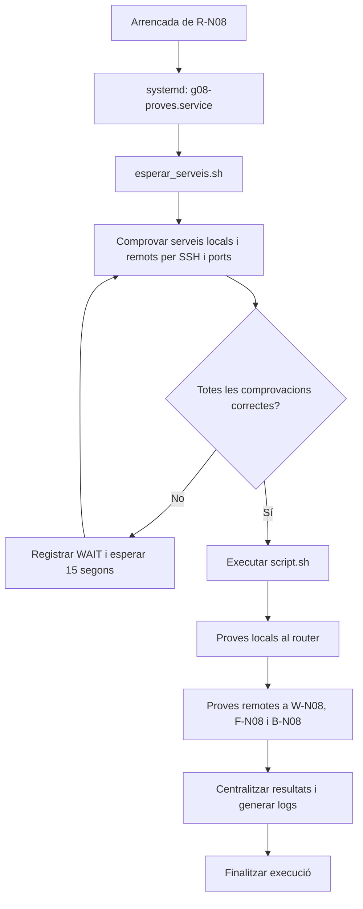

# Joc de proves automàtic — G08

## 1. Objectiu

El joc de proves permet verificar automàticament el funcionament de la infraestructura multicapa del projecte P0.0-ASIXc2gA-G08 a Isard VDI. El router R-N08 centralitza les comprovacions i els resultats de les quatre màquines virtuals. No cal iniciar manualment els scripts després de cada arrencada.

## 2. Màquines i serveis

| Equip | Adreça IP | Servei | Comprovació prèvia |
| --- | --- | --- | --- |
| R-N08 | 192.168.10.1 / 192.168.20.1 | dnsmasq i nftables | Serveis habilitats i actius |
| W-N08 | 192.168.10.10 | Apache2 | Servei habilitat i actiu, TCP 80 i HTTP 200 |
| F-N08 | 192.168.10.11 | vsftpd | Servei habilitat i actiu, TCP 21 |
| B-N08 | 192.168.20.10 | MySQL | Servei habilitat i actiu, TCP 3306 |

## 3. Fitxers del joc de proves

- [`esperar_serveis.sh`](scripts/esperar_serveis.sh): comprova que tots els serveis estiguin preparats abans de començar.
- [`script.sh`](scripts/script.sh): executa les proves locals i remotes, classifica els resultats i genera els registres.
- [`g08-proves.service`](scripts/g08-proves.service): unitat systemd que inicia automàticament el procés al router.

## 4. Funcionament general



### 4.1. Script d'espera

El fitxer `esperar_serveis.sh` s'executa exclusivament a R-N08. Consulta `systemctl is-enabled` i `systemctl is-active` localment per a dnsmasq i nftables, i mitjançant SSH per a Apache2, vsftpd i MySQL. També comprova els ports TCP 80, 21 i 3306 i exigeix una resposta HTTP 200 del servidor web.

Si alguna comprovació falla, registra l'estat `WAIT` i espera 15 segons abans de repetir el cicle. No hi ha un límit global d'espera. Si falta la clau SSH, el fitxer known_hosts o una ordre necessària, finalitza amb error en lloc d'esperar indefinidament.

Quan totes les comprovacions són correctes, valida la sintaxi de `script.sh` i el llança amb:

```bash
bash /opt/joc-proves/script.sh --role router --remote --non-interactive --ssh-user isard
```

L'opció `--check-once` permet fer una sola comprovació sense iniciar el joc de proves.

### 4.2. Script principal

`script.sh` selecciona les proves segons el rol de la màquina. En el mode automàtic, primer executa les proves del router i després envia el seu propi codi per SSH als tres servidors. No cal instal·lar una còpia permanent del script en aquests servidors. Els resultats remots es recuperen en un format estructurat i s'incorporen als registres del router.

| Equip | Proves principals |
| --- | --- |
| R-N08 | Interfícies i adreces IP, rutes, reenviament IPv4, DNS, configuració DHCP, nftables, NAT, ping, ports, web, FTP i sortida HTTPS a Internet. |
| W-N08 | Apache, mòdul PHP mysqli, contingut web, accés a MySQL, restriccions de xarxa i sortida a Internet. |
| F-N08 | vsftpd, port 21, configuració d'usuaris locals, rebuig d'anònims segons configuració, mode passiu 40000–40100, chroot, restriccions cap a MySQL i sortida a Internet. |
| B-N08 | MySQL, port 3306, recompte de dades si hi ha permisos (2710 files i 1982 identificadors únics), ping i accés web. |

El script també admet el rol `client`, però els clients no formen part de l'execució automàtica actual. El client Linux es pot incloure amb `--client-ip` si disposa d'accés SSH; Windows no està automatitzat amb aquest script.

### 4.3. Servei systemd

El servei `g08-proves.service` està configurat com a `Type=oneshot`, amb `User=root` i dependència d'arrencada de `network-online.target`. Executa `/opt/joc-proves/esperar_serveis.sh`, sense límit de temps d'inici (`TimeoutStartSec=infinity`). La sortida està disponible al journal de systemd. Quan està habilitat, inicia el procés en cada arrencada normal del router.

## 5. Instal·lació i requisits

Els dos scripts han d'estar a `/opt/joc-proves/` i la unitat a `/etc/systemd/system/g08-proves.service`. Des de l'arrel del repositori, en el router:

```bash
sudo mkdir -p /opt/joc-proves
sudo install -m 755 "joc de proves/scripts/esperar_serveis.sh" /opt/joc-proves/
sudo install -m 755 "joc de proves/scripts/script.sh" /opt/joc-proves/
sudo install -m 644 "joc de proves/scripts/g08-proves.service" /etc/systemd/system/
sudo systemctl daemon-reload
sudo systemctl enable g08-proves.service
```

Cal disposar de Bash, systemd, client SSH, curl i les eines de xarxa necessàries. Les proves específiques també requereixen les eines dels serveis corresponents (per exemple, nft, PHP o MySQL).

### Accés SSH

Es reutilitza la clau existent de l'usuari `isard` a `/home/isard/.ssh/id_ed25519`. La clau pública ha d'estar autoritzada a W-N08, F-N08 i B-N08. Les empremtes dels servidors han d'estar verificades al fitxer `/home/isard/.ssh/known_hosts`. El mode BatchMode impedeix que es demanin contrasenyes durant l'arrencada; cal que la clau sigui utilitzable sense interacció.

No s'han de publicar claus privades, contrasenyes ni fitxers de registres al repositori.

## 6. Registres i interpretació dels resultats

Els registres centrals es desen a `/opt/joc-proves/logs/` i s'amplien en cada execució.

| Fitxer | Contingut |
| --- | --- |
| `espera_serveis.log` | Intents d'espera, serveis preparats i pendents. |
| `execucio.log` | Resultats de les proves, identificador d'execució i resum final. |
| `errors.log` | Proves amb estat KO. |
| `resultats.csv` | Resultats estructurats amb data, execució, equip, rol, identificador, estat, prova i detall. |

Els servidors remots també generen registres a `./logs-g08` respecte del directori de treball de la sessió SSH.

| Estat | Significat |
| --- | --- |
| OK | La comprovació compleix el resultat esperat. |
| KO | La comprovació no compleix el resultat esperat. |
| AVIS | Hi ha una limitació o un resultat que requereix revisió. |
| OMITIDA | La prova no s'ha pogut executar o no està habilitada. |

## 7. Comprovació després de reiniciar

Després d'encendre les quatre màquines, no cal executar manualment els scripts. Al router es pot consultar l'execució del darrer arrencament amb:

```bash
sudo journalctl -u g08-proves.service -b --no-pager
```

Per seguir-la en directe:

```bash
sudo journalctl -fu g08-proves.service
```

Per consultar l'estat final i els resultats:

```bash
sudo systemctl show g08-proves.service -p ActiveState -p Result -p ExecMainStatus
sudo tail -n 30 /opt/joc-proves/logs/execucio.log
sudo cat /opt/joc-proves/logs/errors.log
sudo cat /opt/joc-proves/logs/resultats.csv
```

Cal localitzar el missatge `PREPARAT`, l'inici del joc de proves i el resum `RESULTAT: OK=... | KO=... | AVIS=... | OMITIDES=...` del mateix arrencament. Si encara hi ha missatges `WAIT`, el procés continua esperant. Quan finalitza correctament, és normal que una unitat oneshot aparegui com a `inactive (dead)`.

El script principal retorna 0 si no hi ha cap KO i 1 si n'hi ha algun. Un resultat `success` de systemd no garanteix que totes les proves s'hagin executat: cal revisar també els avisos i les proves omeses. Els fitxers de logs acumulen execucions anteriors; cal comprovar la data i l'identificador corresponents.

## 8. Limitacions i conclusions

L'execució automàtica no activa les opcions `--ftp-login` ni `--ftp-write`; per tant, no valida l'autenticació FTP d'un usuari ni la transferència de fitxers. El recompte MySQL es pot ometre si no hi ha permisos d'autenticació. Les proves de ports bloquejats o ping sense resposta no demostren per si soles que el tallafoc sigui la causa del bloqueig.

El sistema centralitza les comprovacions, redueix les tasques manuals i facilita la detecció d'incidències després d'arrencar les màquines. Aquesta documentació descriu el comportament del codi; la validació final s'ha de fer amb els registres reals de les quatre màquines.
