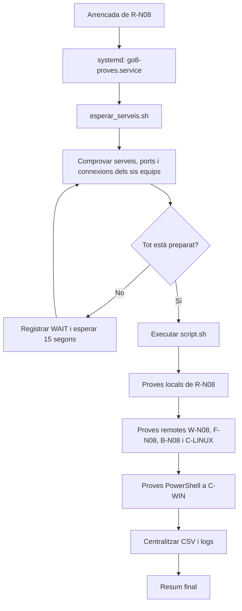
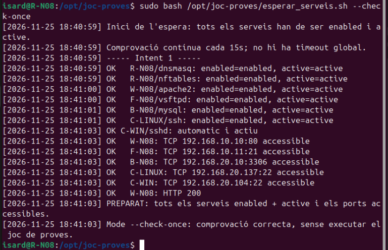
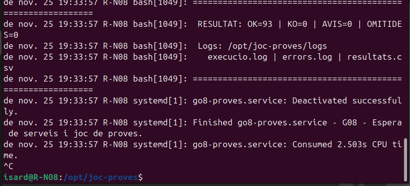

# Joc de proves automàtic — P0.0-ASIXc2gA-G08

## 1. Objectiu

El joc de proves G08 comprova automàticament l'estat i la connectivitat de la infraestructura multicapa del projecte. El router **R-N08** centralitza l'execució, espera que els equips i serveis necessaris estiguin disponibles i recull els resultats de les comprovacions locals i remotes.

La versió documentada integra sis equips:

- **R-N08**: router, DHCP, DNS, encaminament i tallafoc.
- **W-N08**: servidor web Apache2 i aplicació PHP.
- **F-N08**: servidor FTP vsftpd.
- **B-N08**: servidor MySQL.
- **C-LINUX**: client Ubuntu.
- **C-WIN**: client Windows.

La validació final registrada durant el projecte va donar **93 proves correctes, 0 fallides, 0 avisos i 0 omeses**. Aquest resultat és una evidència d'una execució concreta; després de canvis de configuració o de codi cal tornar a executar les proves.

## 2. Topologia i adreçament

| Equip | Adreça IP | Funció / serveis |
|---|---:|---|
| R-N08 | 192.168.10.1 / 192.168.20.1 | Router, dnsmasq i nftables |
| W-N08 | 192.168.10.10 | Apache2, PHP i accés a MySQL |
| F-N08 | 192.168.10.11 | vsftpd |
| B-N08 | 192.168.20.10 | MySQL |
| C-LINUX | 192.168.20.137 | Client Ubuntu |
| C-WIN | 192.168.20.104 | Client Windows i OpenSSH Server |

Les IP dels clients es reserven al DHCP mitjançant les adreces MAC. Les interfícies del router utilitzades pel codi són:

| Interfície | Ús | Adreça / comportament comprovat |
|---|---|---|
| `enp1s0` | WAN | Ruta per defecte cap a Internet |
| `enp2s0` | VPN | No ha de tenir la ruta per defecte |
| `enp3s0` | DMZ | Xarxa 192.168.10.0/24 |
| `enp4s0` | LAN | Xarxa 192.168.20.0/24 |

## 3. Fitxers del joc de proves

Els fitxers executables es desen al repositori dins de `joc de proves/scripts/` i s'instal·len al router a `/opt/joc-proves/`.

| Fitxer | Funció |
|---|---|
| `scripts/esperar_serveis.sh` | Espera que els serveis, ports i connexions necessaris estiguin preparats. |
| `scripts/script.sh` | Executa les proves locals i remotes, classifica els resultats i genera els logs. |
| `scripts/go8-proves.service` | Unitat systemd que inicia el procés automàticament en arrencar R-N08. |

La configuració local de credencials i les claus SSH **no formen part del repositori**.

## 4. Funcionament general



### 4.1. Espera dels serveis

`esperar_serveis.sh` s'executa al router. Per defecte, repeteix les comprovacions cada 15 segons i no té un límit global de temps.

Comprova:

- A R-N08: `dnsmasq` i `nftables` han d'estar habilitats i actius.
- A W-N08: `apache2` habilitat i actiu, TCP 80 accessible i resposta HTTP 200.
- A F-N08: `vsftpd` habilitat i actiu i TCP 21 accessible.
- A B-N08: `mysql` habilitat i actiu i TCP 3306 accessible.
- A C-LINUX: `ssh` habilitat i actiu i TCP 22 accessible.
- A C-WIN: `sshd` ha d'estar en execució i configurat amb inici automàtic; TCP 22 també ha de ser accessible.

Les comprovacions remotes es fan amb SSH i autenticació per clau. Quan hi ha alguna comprovació pendent, el script registra `WAIT`, espera 15 segons i torna a provar-ho.

L'opció `--check-once` fa una sola ronda de comprovacions i no inicia el joc de proves:

```bash
sudo bash /opt/joc-proves/esperar_serveis.sh --check-once
```

Un codi de sortida 0 indica que els requisits previs estan preparats; un codi diferent de 0 indica que hi ha alguna comprovació pendent o un error de configuració.



### 4.2. Execució de les proves

Quan tots els requisits previs són correctes, el script d'espera executa `script.sh` amb el rol `router`, el mode remot i la IP de C-LINUX. La IP de C-WIN es proporciona mitjançant la variable `G08_WIN_IP`.

El script principal:

1. Executa les proves locals de R-N08.
2. Envia el codi de proves per SSH a W-N08, F-N08, B-N08 i C-LINUX.
3. Executa un conjunt de 17 comprovacions PowerShell a C-WIN.
4. Recull els resultats estructurats i els incorpora als logs del router.
5. Genera el recompte final `OK`, `KO`, `AVIS` i `OMITIDES`.

No s'ha d'interpretar l'estat `success` de systemd com a prova suficient que totes les comprovacions han passat. També s'ha de revisar el resum del joc de proves i el CSV.

## 5. Recompte de comprovacions

La versió validada conté 93 registres de comprovació:

| Àmbit | Nombre |
|---|---:|
| R-N08: proves locals | 33 |
| Resultat de l'execució remota SSH (W-N08, F-N08, B-N08 i C-LINUX) | 4 |
| W-N08 | 7 |
| F-N08 | 10 |
| B-N08 | 6 |
| C-LINUX | 15 |
| C-WIN | 17 |
| R40: validació conjunta de les proves remotes | 1 |
| **Total** | **93** |

El detall dels identificadors i de cada comprovació es troba a [Proves](proves.md).

## 6. Instal·lació i configuració

- [Instal·lació](instal·lacio.md): còpia dels scripts, instal·lació de systemd i activació de l'arrencada automàtica.
- [Configuració](configuracio.md): SSH, credencials FTP, usuari de lectura MySQL, UFW, DHCP i Windows.
- [Resultats i diagnòstic](resultats.md): consulta dels logs i interpretació del resum.

## 7. Seguretat i dades sensibles

No s'han de pujar al repositori:

- `/home/isard/.ssh/id_ed25519` (clau privada SSH).
- `/etc/go8-proves.env` (credencials FTP).
- `/home/isard/.mylogin.cnf` de B-N08 (credencials MySQL).
- Logs que puguin contenir dades internes o informació sensible.

Les contrasenyes FTP s'injecten al servei mitjançant un fitxer local protegit i es transmeten als equips remots a través de la connexió SSH. El protocol FTP de la pràctica no xifra les credencials durant la connexió FTP; s'ha de considerar un entorn de laboratori, no una configuració recomanada per a producció.

## 8. Evidències

Les captures del projecte s'han de desar a la carpeta `img/` que ja existeix a l'arrel del repositori. Aquesta documentació no crea cap carpeta d'imatges addicional.

La validació final mostrada durant el projecte va ser:

```text
RESULTAT: OK=93 | KO=0 | AVIS=0 | OMITIDES=0
```

Per consultar com obtenir i interpretar aquest resultat, vegeu [Resultats](resultats.md).


