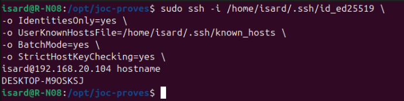
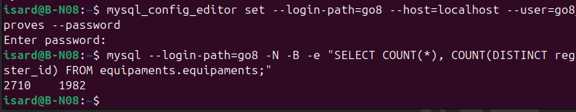
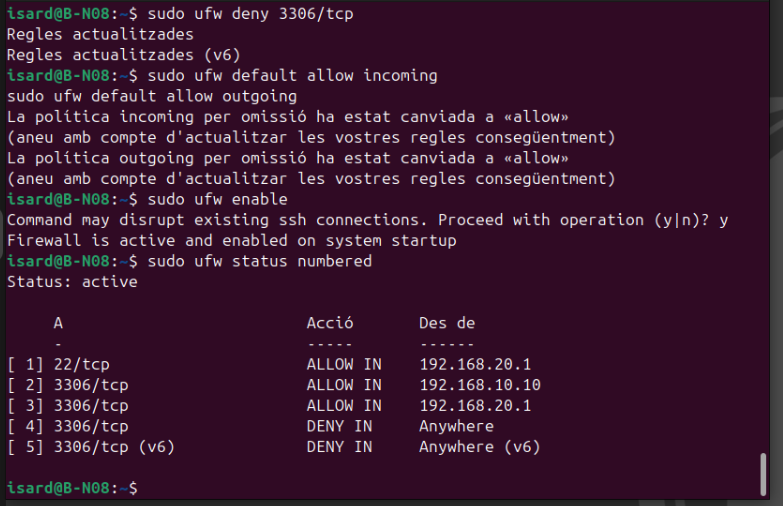

# Configuració dels equips i serveis

Aquest document descriu la configuració necessària perquè el joc de proves centralitzat a R-N08 pugui comprovar els servidors i els clients.

## 1. Adreçament i reserves DHCP

Les adreces utilitzades per la versió validada són:

| Equip | IP | MAC coneguda |
|---|---:|---|
| R-N08 | 192.168.10.1 / 192.168.20.1 | — |
| W-N08 | 192.168.10.10 | — |
| F-N08 | 192.168.10.11 | — |
| B-N08 | 192.168.20.10 | — |
| C-LINUX | 192.168.20.137 | `52:54:00:2a:52:5b` |
| C-WIN | 192.168.20.104 | `52:54:00:62:27:2b` |

A R-N08, les reserves dels clients es gestionen amb dnsmasq. Les línies utilitzades són:

```ini
dhcp-host=52:54:00:2a:52:5b,192.168.20.137,C-LINUX
dhcp-host=52:54:00:62:27:2b,192.168.20.104,C-WIN
```

Les línies es poden mantenir en fitxers separats dins de `/etc/dnsmasq.d/`, per exemple `c-linux.conf` i `c-win.conf`. Abans de reiniciar dnsmasq, validar la configuració:

```bash
sudo dnsmasq --test
sudo systemctl restart dnsmasq
```

Cal comprovar que no hi hagi una altra reserva que utilitzi la mateixa IP o MAC.

## 2. Connexió SSH des del router

R-N08 reutilitza la clau existent de l'usuari `isard`:

- Clau privada: `/home/isard/.ssh/id_ed25519`
- Clau pública: `/home/isard/.ssh/id_ed25519.pub`
- Empremtes acceptades: `/home/isard/.ssh/known_hosts`

La clau pública s'ha d'autoritzar a W-N08, F-N08, B-N08 i C-LINUX. Aquests equips han de permetre que l'usuari `isard` executi les comprovacions necessàries. Les empremtes SSH s'han de verificar abans d'acceptar-les. Els scripts utilitzen `BatchMode=yes` i `StrictHostKeyChecking=yes`, de manera que no demanen contrasenyes ni accepten automàticament empremtes desconegudes.

Exemple de prova des de R-N08:

```bash
ssh -i /home/isard/.ssh/id_ed25519 \
  -o IdentitiesOnly=yes \
  -o UserKnownHostsFile=/home/isard/.ssh/known_hosts \
  -o BatchMode=yes \
  -o StrictHostKeyChecking=yes \
  isard@192.168.20.137 hostname
```

La clau privada no s'ha de copiar al repositori ni als altres equips.

## 3. C-LINUX: OpenSSH Server

A C-LINUX, instal·lar i habilitar el servidor SSH:

```bash
sudo apt update
sudo apt install openssh-server -y
sudo systemctl enable --now ssh
systemctl is-enabled ssh
systemctl is-active ssh
```

Des de R-N08, autoritzar la clau pública existent:

```bash
ssh-copy-id -i /home/isard/.ssh/id_ed25519.pub isard@192.168.20.137
```

Després, comprovar que l'accés funciona en mode no interactiu amb la mateixa clau i el mateix `known_hosts` que utilitza el servei.

## 4. C-WIN: OpenSSH Server i PowerShell remot

A C-WIN, obrir PowerShell com a administrador i instal·lar OpenSSH Server:

```powershell
Add-WindowsCapability -Online -Name OpenSSH.Server~~~~0.0.1.0
Start-Service sshd
Set-Service -Name sshd -StartupType Automatic
Get-Service sshd
```

Permetre SSH des de la IP del router. Si existeix la regla predeterminada, limitar-ne l'origen; si no existeix, crear-la:

```powershell
if (Get-NetFirewallRule -Name "OpenSSH-Server-In-TCP" -ErrorAction SilentlyContinue) {
    Set-NetFirewallRule -Name "OpenSSH-Server-In-TCP" -Enabled True -RemoteAddress 192.168.20.1
} else {
    New-NetFirewallRule -Name "OpenSSH-Server-In-TCP" -DisplayName "OpenSSH Server" -Direction Inbound -Protocol TCP -LocalPort 22 -RemoteAddress 192.168.20.1 -Action Allow
}
```

L'usuari `isard` utilitzat en el projecte pertany al grup local d'administradors. Per aquest motiu, la clau pública del router s'afegeix a:

```text
C:\ProgramData\ssh\administrators_authorized_keys
```

Obtenir la clau pública a R-N08:

```bash
cat /home/isard/.ssh/id_ed25519.pub
```

Afegir-ne el contingut al fitxer de Windows (sense copiar mai la clau privada). A PowerShell com a administrador, ajustar els permisos:

```powershell
icacls "C:\ProgramData\ssh\administrators_authorized_keys" /inheritance:r
icacls "C:\ProgramData\ssh\administrators_authorized_keys" /grant:r "*S-1-5-32-544:F" "*S-1-5-18:F"
Restart-Service sshd
```

Des de R-N08, comprovar tant l'accés SSH com l'execució remota de PowerShell:

```bash
ssh isard@192.168.20.104 hostname
ssh isard@192.168.20.104 'powershell.exe -NoProfile -Command "Get-Service sshd"'
```



## 5. FTP a F-N08

El servei utilitzat és `vsftpd`. La configuració comprovada pel joc de proves inclou:

- `anonymous_enable=NO`
- `local_enable=YES`
- `pasv_min_port=40000`
- `pasv_max_port=40100`
- `chroot_local_user=YES`

L'usuari de proves utilitzat és `bchecker`. La contrasenya s'emmagatzema només al router, al fitxer protegit `/etc/go8-proves.env`, i no es documenta en aquest repositori.

El fitxer local del router conté:

```ini
FTP_USER=bchecker
FTP_PASS="CONTRASENYA_REAL"
```

Permisos recomanats:

```bash
sudo chown root:root /etc/go8-proves.env
sudo chmod 600 /etc/go8-proves.env
```

El servei systemd carrega el fitxer mitjançant un drop-in:

```ini
[Service]
EnvironmentFile=/etc/go8-proves.env
```

La funció de proves FTP comprova el rebuig de l'usuari anònim i, si hi ha credencials, l'autenticació i el llistat en mode passiu. La transferència de fitxers (`--ftp-write`) és una opció addicional i no forma part de l'execució automàtica per defecte.

**Seguretat:** FTP sense TLS no xifra les credencials del protocol FTP. Aquesta configuració s'utilitza en el laboratori de la pràctica i no s'ha de considerar una recomanació per a producció.

## 6. MySQL a B-N08

La base de dades és `equipaments` i la taula comprovada és `equipaments`. El recompte esperat és:

- 2710 files totals.
- 1982 valors diferents de `register_id`.

Es crea un usuari específic de només lectura:

```sql
CREATE USER 'go8_proves'@'localhost' IDENTIFIED BY RANDOM PASSWORD;
GRANT SELECT ON equipaments.equipaments TO 'go8_proves'@'localhost';
```

MySQL mostra una contrasenya generada. No s'ha de publicar ni afegir al repositori.

A B-N08, amb l'usuari del sistema `isard` i sense `sudo`, desar les credencials amb `mysql_config_editor`:

```bash
mysql_config_editor set --login-path=go8 --host=localhost --user=go8_proves --password
```

Comprovar el recompte:

```bash
mysql --login-path=go8 -N -B -e \
"SELECT COUNT(*), COUNT(DISTINCT register_id) FROM equipaments.equipaments;"
```

El resultat esperat és `2710 1982`. El fitxer `.mylogin.cnf` queda al directori personal de `isard` a B-N08. El joc de proves remot s'executa com aquest usuari i utilitza el login-path `go8`.



## 7. Tallafoc local de B-N08

B-N08 escolta MySQL a TCP 3306. Com que C-LINUX i B-N08 són a la mateixa subxarxa, el trànsit entre ells no passa pel filtratge de forwarding del router. Per això s'aplica el control al mateix B-N08 amb UFW.

Les excepcions de MySQL utilitzades són:

| Origen | IP | Accés TCP 3306 |
|---|---:|---|
| W-N08 | 192.168.10.10 | Permès |
| R-N08 | 192.168.20.1 | Permès |
| C-LINUX | 192.168.20.137 | Denegat |
| Altres orígens | — | Denegat per la regla del port |

També es permet SSH des del router:

```bash
sudo ufw allow from 192.168.20.1 to any port 22 proto tcp
```

Regles MySQL:

```bash
sudo ufw allow from 192.168.10.10 to any port 3306 proto tcp
sudo ufw allow from 192.168.20.1 to any port 3306 proto tcp
sudo ufw deny 3306/tcp
```

A la configuració de laboratori aplicada, les polítiques per defecte d'UFW són `allow incoming` i `allow outgoing`; per tant, el bloqueig documentat és específic del port 3306 i no representa un enduriment general del servidor. Revisar sempre les regles existents abans de reproduir-les en un altre entorn.

Consultar:

```bash
sudo ufw status numbered
sudo nft list ruleset
sudo ss -lntp | grep 3306
```



## 8. Variables i fitxers que no es publiquen

| Element | Ubicació | Motiu |
|---|---|---|
| Clau privada SSH | `/home/isard/.ssh/id_ed25519` a R-N08 | Credencial privada |
| Credencials FTP | `/etc/go8-proves.env` a R-N08 | Conté contrasenya |
| Credencials MySQL | `/home/isard/.mylogin.cnf` a B-N08 | Autenticació MySQL |
| Drop-in systemd | `/etc/systemd/system/go8-proves.service.d/override.conf` | Referencia el fitxer de credencials |

Aquests fitxers s'han de crear localment a cada instal·lació i no s'han d'afegir al repositori Git.
